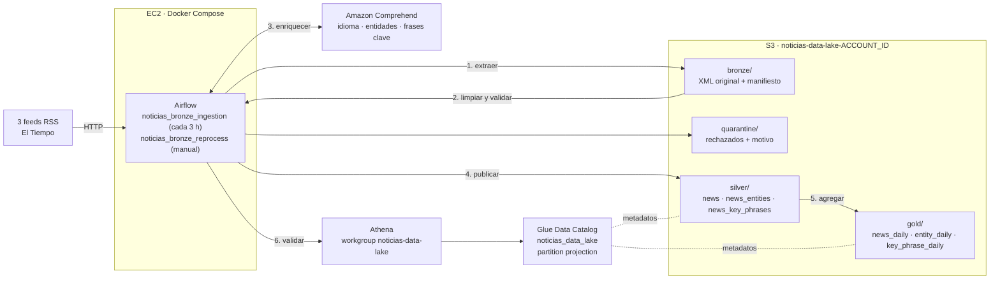

# Taller Data Lake: Noticias RSS (DE 2026-2)

Data lake de noticias de El Tiempo con arquitectura medallón en un solo
bucket de Amazon S3:

- **Bronze**: el XML original de cada feed.
- **Silver**: noticias limpias, deduplicadas, versionadas y enriquecidas con
  Amazon Comprehend.
- **Gold**: agregados diarios.

Apache Airflow, en EC2 con Docker Compose, orquesta el pipeline. AWS Glue
Data Catalog registra las tablas y se consultan con Amazon Athena.

| Documento | Contenido |
|---|---|
| Este README | Arquitectura, fuentes, despliegue, ejecución, evidencias, eliminación y costos |
| [`docs/diseno.md`](docs/diseno.md) | Identificación de noticias, reglas de calidad, actualización, Comprehend, incrementalidad, recuperación y publicación |
| [`docs/diccionario_datos.md`](docs/diccionario_datos.md) | Rutas y columnas de Bronze, cuarentena, Silver y Gold, y la definición de cada métrica |
| [`terraform/ec2/README.md`](terraform/ec2/README.md) | Detalle del despliegue en EC2, acceso y costos de la instancia |

## Arquitectura



El DAG completo es:

```
preflight_checks → extract_rss_to_bronze → prepare_silver_news → enrich_with_comprehend
  → publish_silver_news → build_gold_tables → validate_with_athena → record_run_status
```

En EC2, el rol de la instancia da las credenciales: no hay llaves en el
disco. Los permisos están en tres políticas (S3, Comprehend y Athena/Glue),
compartidas con el usuario que corre el pipeline en local. Bronze no tiene
permiso de borrado.

## Fuentes RSS

Están configuradas en [`config/sources.yaml`](config/sources.yaml):

| `source_id` | Medio | Sección | URL |
|---|---|---|---|
| `eltiempo_medellin` | El Tiempo | Medellín | <https://www.eltiempo.com/rss/colombia_medellin.xml> |
| `eltiempo_tecnosfera` | El Tiempo | Tecnología | <https://www.eltiempo.com/rss/tecnosfera.xml> |
| `eltiempo_deportes` | El Tiempo | Deportes | <https://www.eltiempo.com/rss/deportes.xml> |

Se usa solo el contenido del RSS (título, descripción, enlace, GUID y fecha),
no el texto completo de las notas. Cada feed trae unas 10 noticias.

## Contenido del repositorio

| Ruta | Contenido |
|---|---|
| `config/sources.yaml` | Feeds RSS: medio, sección y URL |
| `src/pipeline/` | `ingestion.py` (Bronze), `silver.py`, `enrichment.py` (Comprehend), `gold.py`, `athena.py`, `checks.py` (preflight, validaciones y estado final) y `dag_tasks.py` |
| `dags/` | `noticias_bronze_ingestion` (programado) y `noticias_bronze_reprocess` (manual) |
| `sql/` | Consultas de Athena: análisis, conciliación, validaciones y bytes escaneados |
| `terraform/s3` | Bucket del data lake |
| `terraform/iam` | Políticas del pipeline y grupo IAM |
| `terraform/catalog` | Base de datos y tablas de Glue, workgroup de Athena |
| `terraform/ec2` | Instancia, rol y security group para Airflow |
| `scripts/` | `scenarios.py` (lotes controlados para las evidencias), `reset_demo.sh`, `run_athena.py` y `check_feeds.py` |
| `tests/` | Pruebas unitarias (sin AWS) |
| `docker-compose.yaml`, `Dockerfile` | Airflow 3.3 con Postgres |
| `.env.example` | Variables de ejemplo, sin secretos |

## Requisitos

- Una cuenta de AWS. La región por defecto es `us-east-2`.
- AWS CLI v2 con dos identidades:
  - un perfil **administrador** (`admin` en estos ejemplos), para crear IAM,
    Glue, Athena y EC2;
  - el perfil **por defecto**, con el usuario que corre el pipeline en local
    (`user_cli` por defecto, variable `pipeline_user_name` de `terraform/iam`).
- Terraform 1.5 o superior.
- Docker y Docker Compose, para correr Airflow en local.
- Python 3.12, solo para las pruebas y los scripts en local.

## 1. Crear la infraestructura base

Se aplican tres stacks en este orden. Los de IAM y catálogo reciben el perfil
administrador por variable.

```bash
aws login --profile admin
eval "$(aws configure export-credentials --profile admin --format env)"

cd terraform/s3       && terraform init && terraform apply
cd ../iam             && terraform init && terraform apply -var aws_profile=admin
cd ../catalog         && terraform init && terraform apply -var aws_profile=admin
cd ../..
```

| Stack | Qué crea |
|---|---|
| `s3` | Bucket `noticias-data-lake-<ACCOUNT_ID>` con versionado, cifrado SSE-S3 y acceso público bloqueado. Una regla de ciclo de vida borra `athena-results/` a los 7 días |
| `iam` | Las políticas `noticias-data-lake-{s3,comprehend,athena}`, asignadas al grupo `noticias-data-lake-pipeline`, del que es miembro el usuario del pipeline |
| `catalog` | La base de datos de Glue `noticias_data_lake`, con 6 tablas Parquet particionadas por `published_date` mediante *partition projection*, y el workgroup de Athena `noticias-data-lake` (motor v3, límite de 1 GiB escaneado por consulta) |

El nombre del bucket aparece en `terraform -chdir=terraform/s3 output bucket_name`.

## 2. Probar en local (opcional)

Sirve para montar y probar los DAGs antes de EC2. **No hay que correr el
Airflow local y el de EC2 a la vez**, porque escriben en el mismo bucket.

```bash
cp .env.example .env           # completar S3_BUCKET
python scripts/check_feeds.py  # opcional: comprobar que los feeds respondan
./setup.sh
```

Las credenciales **no** van en `.env`: `setup.sh` copia el perfil `default` de
`~/.aws` a `.secrets/aws/`, que está en `.gitignore` y se monta en modo de solo
lectura. Luego `setup.sh` ejecuta `docker compose up -d`; el contenedor
`airflow-init` migra la base de datos y crea el pool `silver_writer`.

La interfaz queda en <http://localhost:8080>, con el usuario `admin`. La
contraseña se ve con:

```bash
docker compose exec airflow-apiserver \
  cat /opt/airflow/simple_auth_manager_passwords.json.generated
```

Para apagarlo: `docker compose down`. Sin `-v` se conserva el historial.

## 3. Desplegar en EC2

El mismo `docker compose` corre en una instancia EC2. El detalle está en
[`terraform/ec2/README.md`](terraform/ec2/README.md).

1. Apagar el Airflow local (`docker compose down`).
2. Opcional, para una demo desde cero:
   `scripts/reset_demo.sh --profile admin --yes`. Borra Silver, Gold y la
   cuarentena, y conserva el Bronze real. Sin `--yes` solo muestra qué
   borraría.
3. Publicar la rama y crear la instancia:
   ```bash
   git push -u origin silver-layer
   cd terraform/ec2
   terraform init
   terraform apply -var aws_profile=admin -var repo_branch=silver-layer \
     -var "allowed_cidrs=[\"$(curl -s https://checkip.amazonaws.com)/32\"]"
   ```
   `allowed_cidrs` abre el 8080 solo para la IP propia; el panel va por HTTP
   sin cifrar, por eso no se acepta `0.0.0.0/0`. Si la IP cambia, se repite
   el `apply` con la nueva. `user_data` instala Docker, clona el repo en `/opt/noticias-data-lake` y
   levanta Airflow. Tarda unos 5 minutos. El avance se ve en
   `/var/log/cloud-init-output.log`.
4. Obtener la contraseña del usuario `admin` (desde `terraform/ec2`):
   ```bash
   ID=$(terraform output -raw instance_id)
   CMD=$(aws ssm send-command --profile admin --region us-east-2 --instance-ids "$ID" \
     --document-name AWS-RunShellScript \
     --parameters 'commands=["cd /opt/noticias-data-lake && docker compose exec -T airflow-apiserver cat /opt/airflow/simple_auth_manager_passwords.json.generated"]' \
     --query Command.CommandId --output text)
   aws ssm wait command-executed --profile admin --region us-east-2 --command-id "$CMD" --instance-id "$ID"
   aws ssm get-command-invocation --profile admin --region us-east-2 --command-id "$CMD" --instance-id "$ID" \
     --query StandardOutputContent --output text
   ```
5. Entrar a `http://<IP pública>:8080` (`terraform output -raw public_ip`)
   con `admin` y esa contraseña.
6. Para una terminal en la instancia, sin llaves: EC2 → Instancias →
   `noticias-data-lake-airflow` → **Connect** → *EC2 Instance Connect*. El
   puerto 22 está abierto solo para el servicio de Instance Connect.

## 4. Ejecutar el pipeline

Los DAGs se crean pausados. Para empezar, actívalos desde la interfaz.

### Ingesta programada: `noticias_bronze_ingestion`

Corre cada 3 horas (`0 */3 * * *`), con `max_active_runs=1` y `retries=2`.
También se puede lanzar con **Trigger** en la interfaz o con
`docker compose exec airflow-apiserver airflow dags trigger noticias_bronze_ingestion`.

El resultado de cada corrida queda en
`gold/_runs/run_id=<run_id>/status.json`:

- el estado final (`complete`, `partial` o `failed`);
- los conteos de cada etapa;
- las validaciones de Athena.

Un lote **parcial** (una fuente falló) publica las fuentes buenas y deja
`record_run_status` **en rojo**, con la fuente que falló.

### Reproceso desde Bronze: `noticias_bronze_reprocess`

Reprocesa un lote ya guardado sin consultar los RSS: verifica el SHA-256 y
vuelve a correr Silver, Comprehend y Gold. Hay que pasarle el lote como conf:

```bash
docker compose exec airflow-apiserver airflow dags trigger noticias_bronze_reprocess \
  --conf '{"run_id": "scheduled__2026-11-02T06:00:00+00:00"}'
# Para reconstruir todo Gold: {"run_id": "…", "full_gold": true}
```

### Recuperar una corrida

- **Lote parcial o fallido**: **Clear** sobre `extract_rss_to_bronze`,
  marcando *Downstream*. Solo se vuelven a consultar las fuentes que fallaron.
- **Una tarea fallida**: **Clear** sobre esa tarea, marcando *Downstream*.
  Cada etapa lee su entrada de S3, así que la reejecución no duplica
  resultados (ver [diseño](docs/diseno.md#recuperación-e-idempotencia)).

## 5. Consultar con Athena

En la consola de Athena, elige el workgroup **`noticias-data-lake`** y la base
de datos **`noticias_data_lake`**.

| Capa | Tablas |
|---|---|
| Silver | `news`, `news_entities`, `news_key_phrases` |
| Gold | `news_daily`, `entity_daily`, `key_phrase_daily` |

Las particiones nuevas se ven de inmediato, sin `MSCK REPAIR` ni crawler.
Para escanear menos datos, filtra por `published_date` (texto `AAAA-MM-DD`).

| Archivo | Pregunta |
|---|---|
| [`sql/01_noticias_por_fecha_seccion.sql`](sql/01_noticias_por_fecha_seccion.sql) | Noticias por día, medio y sección |
| [`sql/02_top_organizaciones.sql`](sql/02_top_organizaciones.sql) | Las 10 organizaciones presentes en más noticias |
| [`sql/03_presencia_entidad.sql`](sql/03_presencia_entidad.sql) | Presencia de una entidad entre días, incluidos los días en 0 |
| [`sql/04_frases_por_seccion.sql`](sql/04_frases_por_seccion.sql) | Las 5 frases clave más frecuentes por sección |
| [`sql/05_conciliacion_silver_gold.sql`](sql/05_conciliacion_silver_gold.sql) | Diferencias entre Gold y Silver (vacío = conciliado) |
| [`sql/06_validaciones_calidad.sql`](sql/06_validaciones_calidad.sql) | Reglas de calidad, cada una con su número de fallas; las usa el DAG |
| [`sql/07_bytes_escaneados.sql`](sql/07_bytes_escaneados.sql) | La misma consulta con y sin filtro de partición |

Desde la terminal, cada archivo imprime sus filas y los bytes escaneados:

```bash
.venv/bin/python scripts/run_athena.py sql/*.sql
```

## 6. Escenarios de evidencia

Se corren en la terminal de EC2, desde `/opt/noticias-data-lake`. Cada
escenario crea un lote controlado en Bronze a partir de las últimas capturas
reales y lo procesa con el DAG de reproceso: es el mismo código del pipeline,
y no depende de que el medio publique algo.

| Escenario | Cómo se ejecuta | Resultado esperado |
|---|---|---|
| Carga inicial | Activar `noticias_bronze_ingestion` con Silver y Gold vacíos | Datos en Bronze, Silver y Gold, consultables en Athena |
| Repetir un lote | **Clear** de una corrida completa | 0 nuevas, 0 particiones reescritas, 0 textos a Comprehend |
| Lote incremental | **Trigger** de una corrida nueva | Solo las noticias nuevas se publican y se analizan |
| Registros defectuosos | `sudo docker compose exec airflow-apiserver python scripts/scenarios.py defectuosos --trigger` | 5 items en `quarantine/` con su motivo y su referencia a Bronze |
| Noticia modificada | `… scenarios.py modificada --trigger` | La versión sube, Comprehend analiza solo ese texto y se reescribe una partición |
| Lote parcial | `… scenarios.py parcial --trigger` | Se publican las fuentes buenas y `record_run_status` queda en rojo |
| Fallo controlado y reejecución | Variable `noticias_fail_task` = `publish_silver_news`, luego **Trigger**; borrar la Variable | La tarea falla y el reintento (o un Clear) la recupera sin duplicar |
| Reproceso desde Bronze | `noticias_bronze_reprocess` con `{"run_id": "…"}` | Se reconstruye sin consultar los RSS y sin duplicar |
| Partición nueva | Consultar Athena después de una corrida que trae una fecha nueva | La partición aparece sin registrarla |

## 7. Pruebas

Las pruebas usan objetos falsos y no se conectan a AWS.

```bash
./setup_python_env.sh        # crea .venv e instala requirements.txt
.venv/bin/python -m pytest
```

## 8. Eliminar los recursos

En este orden: EC2 e IAM dependen de las políticas, y el bucket va al final.
**Vaciar el bucket borra todos los datos**, incluido Bronze, y no se puede
deshacer.

```bash
aws login --profile admin
eval "$(aws configure export-credentials --profile admin --format env)"

# 1. Instancia, rol y security group (se borra con sus reglas)
terraform -chdir=terraform/ec2     destroy -var aws_profile=admin

# 2. Tablas de Glue y workgroup de Athena
terraform -chdir=terraform/catalog destroy -var aws_profile=admin

# 3. Políticas y grupo IAM
terraform -chdir=terraform/iam     destroy -var aws_profile=admin

# 4. Vaciar el bucket con todas sus versiones y marcadores de borrado
#    (Terraform no borra un bucket con contenido). Usa las credenciales
#    exportadas arriba: boto3 no lee directamente un perfil de "aws login"
#    sin el paquete botocore[crt].
BUCKET=$(terraform -chdir=terraform/s3 output -raw bucket_name)
.venv/bin/python -c "import boto3, sys; boto3.Session(region_name='us-east-2').resource('s3').Bucket(sys.argv[1]).object_versions.delete()" "$BUCKET"

# 5. El bucket
terraform -chdir=terraform/s3      destroy

# 6. Airflow local, si se usó (-v borra también su base de datos)
docker compose down -v
```

Cada `destroy` muestra el plan y pide confirmación.

## 9. Estimación de costos

Precios on-demand en us-east-2. El volumen es de unas 30 noticias por
lote, de las cuales pocas son nuevas.

| Servicio | Base del cálculo | Costo estimado |
|---|---|---|
| EC2 `t3.medium` + IPv4 pública + gp3 30 GiB | ~USD 0,05 por hora encendida | **~USD 0,40 por 8 h de demo**; detenida, solo el disco: ~USD 2,4 al mes |
| Amazon Comprehend | USD 0,0001 por unidad de 100 caracteres, mínimo 3 unidades por texto y API. Por noticia: idioma + entidades + frases ≈ 9 unidades ≈ USD 0,0009 | Carga inicial de 30 noticias: ~USD 0,03. Después, solo las noticias nuevas o modificadas, más 1 llamada mínima de preflight por corrida (USD 0,0003) |
| Amazon Athena | USD 5 por TB escaneado, mínimo 10 MB por consulta (USD 0,00005) | Validaciones de cada corrida y consultas de análisis: menos de USD 0,01 al día |
| Amazon S3 | Pocos MB en Bronze, Silver y Gold, más algunos cientos de solicitudes por corrida | Menos de USD 0,05 al mes |
| AWS Glue Data Catalog | 6 tablas, sin particiones registradas (projection) | USD 0, dentro del nivel gratuito (1 millón de objetos y solicitudes) |
| Session Manager / Instance Connect | | USD 0 |

**Total para el taller**: menos de USD 1 por día de trabajo con la instancia
encendida. El mayor costo es dejar EC2 encendida: 24/7 serían unos USD 36,5
al mes. Hay que detenerla o destruirla al terminar.

## Notas

- La contraseña de Airflow cambia si se recrea el contenedor del api-server.
- En Python 3.14, los scripts que usan `pyarrow` pueden quedarse colgados al
  terminar. En ese caso conviene correrlos dentro del contenedor:
  `docker compose exec -T airflow-apiserver python …`.
